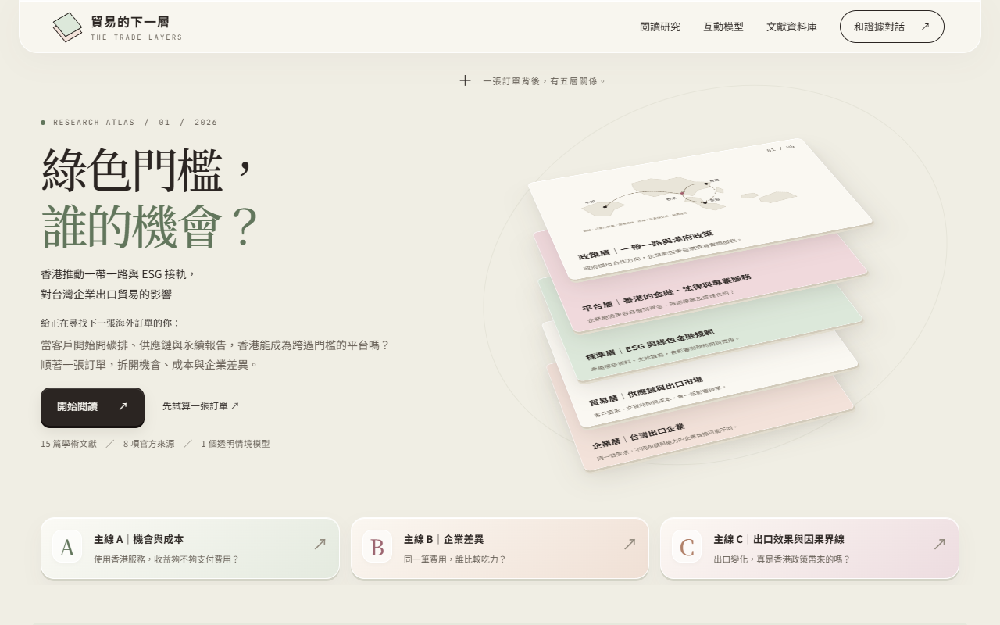

# 香港推動一帶一路與 ESG 接軌，對台灣企業出口貿易的影響

以台灣出口商的實際問題為起點，整理香港金融及專業服務、ESG 要求與出口成本之間的關係。包含單頁互動網站、22 頁可編輯簡報、講稿、2015–2025 年 20 篇文獻證據表（19 篇期刊、1 篇學位論文）及 8 項官方來源。

## 三條研究主線

- **A｜機會與成本**：使用香港服務，收益夠不夠支付費用？
- **B｜企業差異**：同一筆費用，規模不同的企業是否面臨不同負擔？
- **C｜出口效果與因果界線**：出口變化是否真由香港政策造成？

## 線上入口

- 課堂網站與問答：https://hk-esg-taiwan-classroom.onrender.com/
- GitHub Pages 閱讀版：https://yan-0202.github.io/hk-esg-taiwan-trade/
- 報告者管理頁：課堂網址後加 `/admin`。管理密碼不在儲存庫，請使用本機交付的私人檔案。

上課在管理頁設定 Gemini 金鑰，開放 2 小時；下課按關閉。重新啟動服務會清除記憶體金鑰並關閉課堂，需重新設定。Render 免費服務閒置會休眠，首次開啟可能需等待。

## 使用

下載整個儲存庫後開啟 `index.html`。圖表與字型使用 CDN，需網路；正文、資料表與離線來源查詢可單獨閱讀。

簡報請開啟 `專題簡報_重新製作.pptx`，每頁附講者備註，另有 `簡報講稿.md`。正文見 `專題正文與架構.md`。

## Gemini 問答

GitHub Pages 僅提供靜態網站，無法執行 Python 問答後端。本專題已新增 Render 雲端服務，請優先使用上方課堂入口；以下為本機備用操作。

1. 安裝 Python 3.10+。Windows 雙擊 `啟動_QA.cmd`；分享給同網路同學則用 `課堂分享_QA.cmd`。
2. 自動開啟本機網頁後，在「設定 Gemini API」貼上金鑰，按「儲存金鑰」，再按「驗證 Google 連線」。支援舊式與新版 AQ. 金鑰。
3. 選擇雲端模式試問一題。設定存在與模型權限、生成額度是不同的檢查；需依 Google 實際回應判斷。
4. 金鑰只留在後端記憶體；同學頁面無法查看或設定。請勿把金鑰提交到 GitHub。
5. 下課在啟動視窗按 Ctrl+C 停止。重新啟動後需重新設定金鑰。

優先使用符合資格且未啟用計費的 Gemini 免費層；免費額度依 Google 政策及帳戶而異。本機每次啟動最多 60 次雲端嘗試，不自動切換付費供應商。

## 資料與研究限制

歷史圖使用 2023–2024 官方資料；陸港合計不能當香港單列。模型參數為教學假設，未用企業樣本校準，不能當出口預測或政策因果估計。

本次文獻整理尚未找到同時識別香港、一帶一路、ESG 與台灣出口淨因果效果的合適研究；未找到不等於不存在。每篇文獻的閱讀範圍與適用限制見 `文獻證據表.csv`。跨資料來源核對不代表所有全文皆已精讀。

`QA_SKILL.md` 是問答來源及引用約束，不是模型訓練，也不能保證所有回答正確。真實金鑰與 Google 免費生成額度需要使用者自行驗證。

## 2026-11-17 文獻版修訂

HTML、正文、模型與 QA 來源已同步改為 2015–2025 文獻範圍。PPT 與預覽圖仍是上一版，尚未同步本次文獻及公式變更。見 `2015-2025修訂與查核紀錄.md`。19 篇 DOI 書目已核對，另 1 篇依大學典藏核對；摘要層級查核不等同全文複現。

## 統計窗口與分章文稿

出口圖已補2015–2025；金融僅核對2023–2025，其餘缺值。詳見 `統計與文稿修訂紀錄.md`。Word文稿：`專題分章文稿_2015-2025.docx`（另附PDF）。
